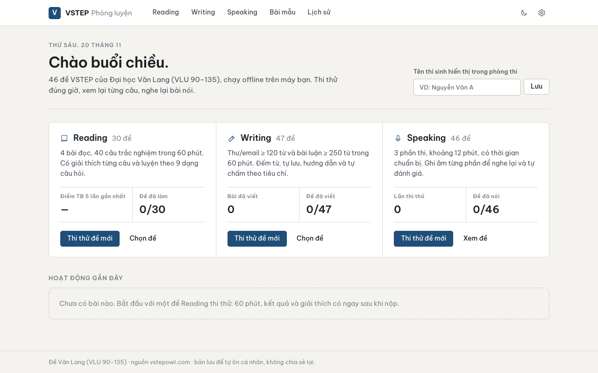
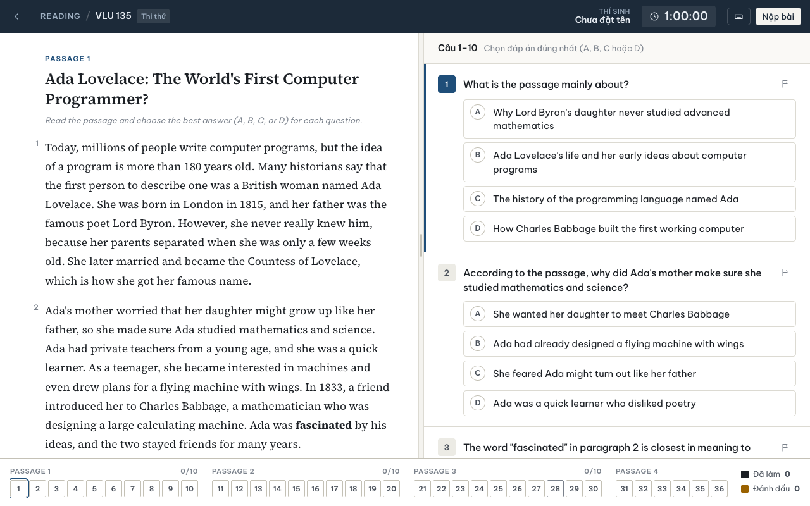
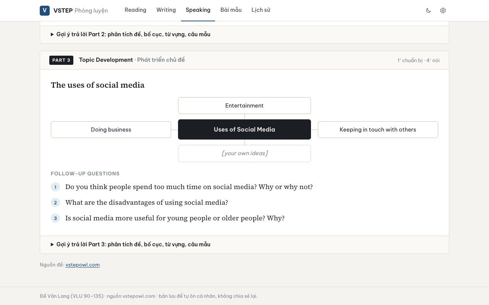
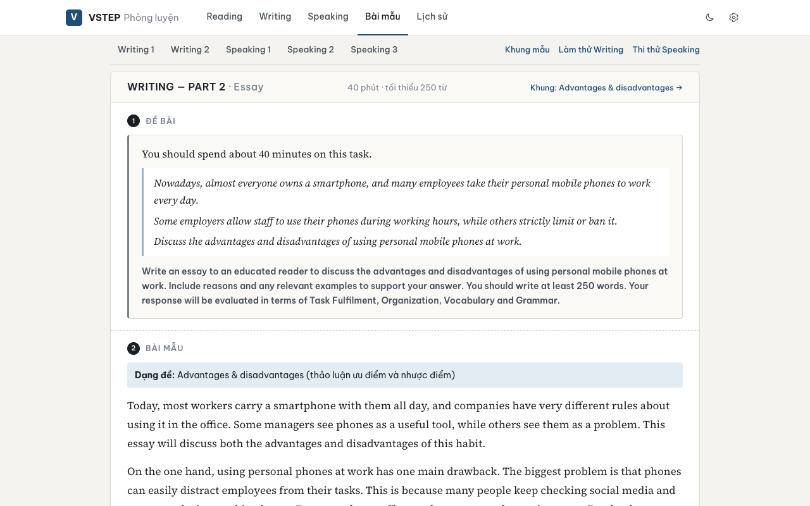
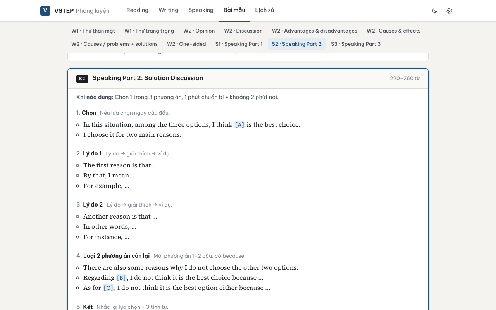

<div align="center">

# VSTEP Phòng luyện

**Bộ tự học VSTEP B1–B2 chạy offline: 86 đề Văn Lang (VLU 50–135), thi thử đúng giờ, bài mẫu mục tiêu 5–6 điểm và khung câu để học thuộc.**

`Reading 54 đề · 2.160 câu` · `Writing 87 đề` · `Speaking 86 đề` · `Bài mẫu 87 đề` · `11 khung mẫu`



</div>

> [!IMPORTANT]
> Đề thi lấy từ [vstepowl.com](https://vstepowl.com) (Exam Reviews). Chủ trang đã cho phép dùng đề để tự học công khai. Bản này **không dùng cho mục đích thương mại**.

---

## Mục lục

- [Có gì trong này](#có-gì-trong-này)
- [Bắt đầu trong 1 phút](#bắt-đầu-trong-1-phút)
- [Đọc trên điện thoại và deploy](#đọc-trên-điện-thoại-và-deploy)
- [Lộ trình ôn gợi ý](#lộ-trình-ôn-gợi-ý)
- [Bài mẫu và khung mẫu](#bài-mẫu-và-khung-mẫu)
- [Cấu trúc thư mục](#cấu-trúc-thư-mục)
- [Dữ liệu](#dữ-liệu)
- [Thêm đề hoặc sửa bài mẫu](#thêm-đề-hoặc-sửa-bài-mẫu)
- [Phát triển](#phát-triển)
- [Nhật ký cập nhật](#nhật-ký-cập-nhật)

---

## Có gì trong này

| Kỹ năng | Định dạng thi | Trong app |
|---|---|---|
| 📖 **Reading** | 4 bài đọc · 40 câu · 60 phút | Thi thử bấm giờ, có palette câu hỏi, đánh dấu câu và tô sáng bài đọc. Chấm theo thang 10 (0,25 điểm/câu) và quy đổi CEFR. Có giải thích từng câu và **luyện theo 9 dạng câu hỏi**. |
| ✍️ **Writing** | Task 1 thư ≥ 120 từ · Task 2 luận ≥ 250 từ · 60 phút | Phòng thi 60′ hoặc luyện riêng từng task, có đếm từ và tự lưu. Tự chấm theo 4 tiêu chí (Task 2 hệ số 2) và đặt bài của mình cạnh bài mẫu. |
| 🎙️ **Speaking** | Part 1 Social · Part 2 Solution · Part 3 Topic development | Xem đề kèm gợi ý. Thi thử 3 part đúng thời gian, **ghi âm** từng part để nghe lại và tự đánh giá. |
| 📝 **Bài mẫu** | W1, W2, S1, S2, S3 cho mỗi đề | Mỗi phần có đề nguyên văn → bài mẫu → số từ → dàn ý → từ vựng. In hoặc lưu được PDF. |
| 🧩 **Khung mẫu** | 11 khung câu cố định | Học thuộc một lần là dùng được cho mọi đề cùng dạng. |

Mọi thứ chạy **hoàn toàn offline**. Tiến độ lưu trong trình duyệt (localStorage, ghi âm lưu ở IndexedDB) và sao lưu được ở mục Cài đặt.

<table>
<tr>
<td width="50%"><br><sub><b>Reading</b>: phòng thi chia đôi màn hình, có đồng hồ đếm ngược và palette 40 câu</sub></td>
<td width="50%"><br><sub><b>Speaking</b>: đề 3 part, gợi ý trả lời và thi thử có ghi âm</sub></td>
</tr>
<tr>
<td><br><sub><b>Bài mẫu</b>: đề nguyên văn, bài mẫu, số từ, dàn ý và từ vựng</sub></td>
<td><br><sub><b>Khung mẫu</b>: câu khung cố định, chỗ cần điền được tô nổi</sub></td>
</tr>
</table>

## Bắt đầu trong 1 phút

**Cách nhanh nhất (macOS):** nhấp đúp **`VSTEP.command`**. Lần đầu script sẽ cài thư viện. Sau đó nó build lại dữ liệu và mở `http://localhost:4173`. Đóng cửa sổ Terminal là tắt app.

**Hoặc chạy bằng dòng lệnh** (cần Node.js 20 trở lên):

```bash
cd app
npm install
npm run app        # build + mở http://localhost:4173
```

> [!TIP]
> Không muốn chạy app? Mở trực tiếp các trang tĩnh trong `de-thi/reading/`, `de-thi/writing/`, `de-thi/speaking/`. Bài mẫu có sẵn dạng Markdown trong `de-thi/loi-giai/` và PDF trong `de-thi/loi-giai/pdf/`.

## Đọc trên điện thoại và deploy

Bản web công khai tại **https://vstep.pentium.ink** (HTTPS, không cần VPN). Trang chạy trên máy `rtx-1` và đi ra Internet qua Cloudflare Tunnel.

1. Mở địa chỉ trên bằng Safari.
2. Bấm Chia sẻ → **Thêm vào MH chính**. App sẽ mở toàn màn hình, có icon "V".

Giao diện điện thoại được tối ưu cho iPhone 15 Pro:
- **chữ nhỏ, xếp dày**: bài mẫu 13,5px, giãn dòng 1,45, lề 12px;
- thanh điều hướng ở đáy màn hình;
- trên trang bài mẫu, các mục Số từ, Dàn ý, Từ vựng gập lại (bấm để mở).

Đổi cỡ chữ Nhỏ/Vừa/Lớn trong **Cài đặt → Cỡ chữ bài đọc**.

```bash
bash deploy/deploy.sh          # build app → deploy/www → container vstep-web (127.0.0.1:6698) + tunnel vstep
bash deploy/deploy.sh status   # kiểm tra cục bộ và https://vstep.pentium.ink
bash deploy/deploy.sh up       # khởi động lại container (vd. sau reboot)
```

> [!WARNING]
> Nginx chỉ bind `127.0.0.1:6698`. Không đổi sang `0.0.0.0` hay IP LAN/tailnet, và không đưa app lên tunnel `homelab` (tunnel đó chạy ssh.pentium.ink). Public chỉ đi qua tunnel `vstep`. Credential tunnel nằm ở `~/.cloudflared/`, không đưa vào repo.

Lưu ý:
- Trang dùng HTTPS nên có thể ghi âm Speaking. Trình duyệt sẽ hỏi quyền micro lần đầu.
- Bài làm và tiến độ lưu riêng trên từng thiết bị. Muốn chuyển giữa các máy thì dùng Cài đặt → Sao lưu tiến độ.

## Lộ trình ôn gợi ý

Mục tiêu B1–B2 (5–6 điểm), khoảng 1–1,5 giờ mỗi ngày:

| Tuần | Reading | Writing | Speaking |
|---|---|---|---|
| **1. Làm quen** | 2 đề ở chế độ luyện tập (không bấm giờ). Đọc kỹ giải thích. | Học thuộc [khung W1](de-thi/loi-giai/KHUNG-MAU.md#w1_informal) và [khung W2](de-thi/loi-giai/KHUNG-MAU.md#w2_opinion). Chép tay 2 bài mẫu. | Học thuộc khung S1, S2, S3. Nói theo 2 bài mẫu. |
| **2. Theo dạng** | Luyện theo dạng câu hỏi, ưu tiên 2–3 dạng sai nhiều nhất. | Mỗi ngày 1 Task 1 (20′). So với bài mẫu. | Mỗi ngày 1 Part 2 có ghi âm. Nghe lại, đối chiếu khung. |
| **3. Tăng tốc** | 3 đề thi thử 60′. | Mỗi ngày 1 Task 2 (40′). Tự chấm 4 tiêu chí. | 2 lần thi thử đủ 3 part. |
| **4. Thi thử** | Mỗi 2 ngày 1 đề thi thử. | 2–3 lần thi thử 60′ đủ 2 task. | Thi thử hằng ngày; ôn từ vựng ở cuối mỗi bài mẫu. |

**Mẹo:** tự làm trước rồi mới mở **Bài mẫu**. Trong phòng thi Writing, nút "So với bài mẫu" chỉ hiện ra sau khi nộp bài.

## Bài mẫu và khung mẫu

Bài mẫu nhắm mức **5–6 điểm**: câu ngắn (25 từ trở xuống), ngữ pháp an toàn, từ vựng phổ biến, ví dụ cụ thể. Mọi bài cùng dạng dùng **chung một bộ câu khung**, nên học thuộc khung trước rồi chỉ cần chuẩn bị ý cho từng đề.

| Phần | Khung | Độ dài |
|---|---|---|
| W1 | Thư thân mật (`Hi/Dear [Name]` … `Best wishes`) hoặc trang trọng (`Dear Mr/Ms …` → `Yours sincerely`, `Dear Sir or Madam` → `Yours faithfully`). Mỗi ý một đoạn 3–4 câu. | 150–180 từ |
| W2 | 6 dạng: `opinion` · `discussion` · `adv_disadv` · `cause_effect` · `x_solution` · `one_side`. 4 đoạn, mỗi ý triển khai theo **PEER** (Point → Explain → Example → Result). | 270–300 từ |
| S1 | Trả lời thẳng → lý do → chi tiết | 3 câu mỗi câu hỏi |
| S2 | *In this situation, among the three options…* → 2 lý do có ví dụ → loại 2 phương án còn lại → *To sum up…* + 3 tính từ | 220–260 từ |
| S3 | *Firstly / Secondly / Thirdly* + *Another important point…* + *To sum up*. Câu hỏi phụ trả lời 3–4 câu. | 200–260 từ |

- Toàn bộ khung: [`de-thi/loi-giai/KHUNG-MAU.md`](de-thi/loi-giai/KHUNG-MAU.md), hoặc trong app ở **Bài mẫu → Khung mẫu**.
- Bài mẫu từng đề: [`de-thi/loi-giai/`](de-thi/loi-giai/README.md). Mỗi đề có `vlu-N.md` và `pdf/vlu-N.pdf`; bản gộp là `pdf/VSTEP-VLU-90-135-bai-mau.pdf` (PDF chưa xuất cho VLU 50–89).
- Lý do chọn các khung này: đối chiếu với tài liệu luyện thi (Sổ tay B2 30 ngày, TEMPLATE, FORM SPEAKING + WRITING…) trong [`de-thi/loi-giai/doi-chieu/`](de-thi/loi-giai/doi-chieu/README.md).
- Đề tự tạo: `nho-2026-11-20-sang` (đề VLU sáng 20/11/2026 do thí sinh nhớ lại) có trong cả Bài mẫu và phòng thi Writing.

## Cấu trúc thư mục

```text
VSTEP/
├── VSTEP.command           # nhấp đúp để chạy app (macOS)
├── app/                    # web app Vite + React 19 + TypeScript
│   ├── scripts/sync-data.mjs   # de-thi/ → src/data/*.json (tự chạy trước dev/build)
│   ├── src/pages/          # Reading, Writing, Speaking, Bài mẫu, Khung mẫu, Lịch sử…
│   ├── src/lib/            # chấm điểm, lưu trữ, thời gian, ghi âm, kiểu dữ liệu
│   └── tests/              # Vitest (logic + dữ liệu) và Playwright e2e
├── de-thi/                 # NGUỒN DỮ LIỆU DUY NHẤT
│   ├── exams/vlu-N.json    # đề chuẩn hoá: reading, writing, speaking
│   ├── speaking/data.json  # đề Speaking 3 part
│   ├── pdf/vlu-N.pdf       # PDF gốc (kèm đáp án và gợi ý)
│   ├── reading/ writing/ speaking/   # trang HTML tĩnh để ôn không cần app
│   └── loi-giai/           # bài mẫu
│       ├── templates.json  # 11 khung câu cố định
│       ├── prompts/        # đề nguyên văn từng đề
│       ├── answers/        # bài mẫu (JSON), bản đang dùng
│       ├── answers-v1/     # bản cũ, giữ để so sánh
│       ├── vlu-N.md · KHUNG-MAU.md · pdf/   # sinh tự động
│       └── doi-chieu/      # đối chiếu với tài liệu luyện thi
├── tools/
│   ├── parse_exam_pdf.py   # PDF → exams/vlu-N.json
│   ├── build_skill_pages.py
│   └── solutions/          # check.py · build.py · verify_prompts.py · audit.py · export_pdf.mjs
├── deploy/                 # nginx + cloudflared (tunnel vstep): phục vụ app tại vstep.pentium.ink
├── docs/images/            # ảnh chụp màn hình cho README
└── site/                   # bản lưu cũ các trang public (không dùng cho app)
```

## Dữ liệu

| Bộ | Số lượng | Ghi chú |
|---|---|---|
| Reading | 54 đề × 4 bài × 10 câu | Có đáp án, giải thích và 9 dạng câu (Chi tiết · Từ vựng · Quy chiếu · Loại trừ · Suy luận · Ý chính · Mục đích · Thái độ · Chèn câu). Các đề 51, 55, 56, 58, 60, 62, 63, 74, 77, 79–84, 88, 93, 95, 98, 100, 101, 106, 107, 112–115, 124, 125, 127–129 không có phần Reading trên trang. |
| Writing | 86 đề × 2 task, cộng 1 đề tự tạo | Kèm hướng dẫn phân tích đề từ nguồn |
| Speaking | 86 đề × 3 part | Kèm gợi ý trả lời từng part |
| Bài mẫu | 87 đề | Tất cả qua `check.py` với 0 lỗi |

Định dạng JSON của đề được mô tả trong [`de-thi/README.md`](de-thi/README.md).

## Thêm đề hoặc sửa bài mẫu

**Thêm đề VLU mới**

1. Trên trang đề, bấm **Tải đề thi**, bật *Kèm đáp án* và *Kèm gợi ý*. Lưu file thành `de-thi/pdf/vlu-N.pdf`.
2. Tách PDF thành JSON rồi dựng lại các trang tĩnh:
   ```bash
   python3 tools/parse_exam_pdf.py de-thi/pdf/vlu-N.pdf --out de-thi/exams
   python3 tools/build_skill_pages.py
   ```
3. Tạo đề nguyên văn với `python3 tools/solutions/make_prompts.py`, sau đó viết `de-thi/loi-giai/answers/vlu-N.json` theo `templates.json`.

**Sửa hoặc viết bài mẫu** (chạy trong `tools/solutions/`)

```bash
python3 check.py N            # bắt buộc 0 lỗi (số từ, khung, PEER, ví dụ, cặp chào–ký…)
python3 verify_prompts.py     # đề trong bài mẫu khớp nguyên văn với nguồn
python3 build.py              # sinh vlu-N.md, README, KHUNG-MAU.md
python3 audit.py              # số liệu trước/sau so với answers-v1
node export_pdf.mjs http://localhost:4173/   # xuất PDF (cần app đang chạy ở chế độ preview)
```

**Đề tự tạo** (ví dụ đề thí sinh nhớ lại): tạo `prompts/<id>.json` có `"custom": true`, `label`, `note`, `date`, rồi tạo `answers/<id>.json`. Đề này tự xuất hiện trong Bài mẫu và phòng thi Writing.

## Phát triển

```bash
cd app
npm run dev        # http://localhost:5173 (tự chạy sync-data trước)
npm test           # Vitest: chấm điểm, dữ liệu, bài mẫu, khung
npm run e2e        # Playwright trên Chrome đã cài sẵn (tự bật dev server :5173); 2 project: desktop 1440×900 và mobile (iPhone 15 Pro 393×852)
npm run build      # tsc + vite build → app/dist
```

**Công nghệ:**
- Vite 8, React 19, TypeScript, React Router (HashRouter, tách bundle theo route), CSS Modules.
- Responsive: điện thoại (≤720px) có layout riêng, render qua `useMedia`. Cỡ chữ đọc là token `--read-size` / `--prompt-size` trong `src/styles/tokens.css`.
- Font: Be Vietnam Pro và Source Serif 4.
- Lưu trữ: localStorage và IndexedDB (`idb-keyval`).
- Ghi âm và đo mức âm thanh: MediaRecorder + WebAudio.


## Nhật ký cập nhật

| Ngày | Thay đổi |
|---|---|
| 25/11/2026 | Thêm **VLU 50–89** (40 đề): 22 đề Reading (880 câu), Writing + Speaking đủ 40 đề, cùng 40 bộ bài mẫu đã rà soát. Tổng cộng: 86 đề, 87 bộ bài mẫu. |
| 20/11/2026 | Viết lại toàn bộ bài mẫu theo 11 khung cố định (PEER, khung S2/S3) sau khi đối chiếu tài liệu luyện thi. Thêm trang Khung mẫu và đề tự tạo VLU sáng 20/11. |
| 19/11/2026 | Bổ sung VLU 123–135. Ra mắt app luyện thi và bài mẫu 5–6 điểm cho VLU 90–135. |

---

<sub>Đề thi thuộc vstepowl.com, dùng với sự cho phép của chủ trang để ôn luyện. Bài mẫu, khung mẫu và mã nguồn app được viết riêng cho bộ tự học này.</sub>
